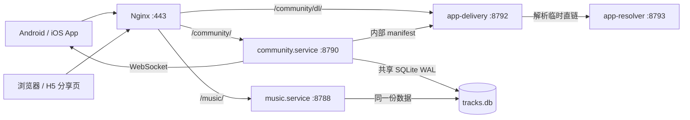

# 流萤社区 · Liuying Community

> 短视频 + 图文混合社区，Flutter 单代码库同时构建 Android / iOS，Python 模块化单体后端与流萤音乐共享账号和数据平面。
>
> 当前源码版本：`0.9.64+135`

流萤社区不是“再做一个泛社交 App”，而是围绕二次元创作者与流萤 IP 的轻社区：内容以图文、短视频、投票和话题为主，互动以关注、私信、今日状态、戳一戳、一起听/一起看为骨架，另带独立应用市场、会员、邀请返现、管理后台和社区 AI「流小萤」。

## 1. 前后端一句话

- **前端**：Flutter 3.x / Dart，单代码库双端；五个常驻 Tab（首页、版块、短视频、消息、我的），自研沉浸黑设计系统与动效语言；页面通过 `ApiClient` 与 `services/` 访问后端，短视频、图集、私信、应用市场、热更新都在同一壳内。
- **后端**：Python 3 标准库 `ThreadingHTTPServer` + SQLite WAL 的模块化单体；`server.py` 只做 HTTP 传输，`app.py` 管请求生命周期，`routes.py` 是领域路由唯一事实来源，业务按 `handlers/<domain>.py` 分域；应用下载拆出 `app-resolver` / `app-delivery` 两个无数据库服务。
- **共享数据平面**：社区与流萤音乐共用 `tracks.db`，账号、token、关注、通知、曲库互通；社区只新增 `community_*` 表，不改音乐表结构。音乐进程停服时，社区登录、信息流、头像/封面/配乐代理仍可独立工作。

## 2. 技术栈

| 层 | 选型 | 说明 |
|---|---|---|
| 客户端 | Flutter / Dart 3.13+ | Android、iOS 单代码库；Material 3 基础 + 自研设计令牌 |
| 状态与数据 | `setState` + `ChangeNotifier` / 全局 Bus | 不引入额外状态管理库；按页面和领域维护请求资格 |
| 本地存储 | `shared_preferences` + `flutter_secure_storage` | 偏好走 SP，token 走 Keychain / Keystore |
| 媒体 | `video_player`、`just_audio`、`cached_network_image`、`photo_view` | 短视频、配乐、图集、封面与头像 |
| 后端 | Python 3.12 标准库 HTTP Server | 无 Web 框架；线程池处理请求，单请求一连接 |
| 数据库 | SQLite（WAL） | 与音乐共享文件；生产为单机部署 |
| 实时 | WebSocket | 通知、私信、官方消息未读推送 |
| 后台 | 单页 H5（`community/templates/admin.html`） | 审核、用户、内容、会员、应用市场、站点配置 |
| 人机验证 | Cap 自托管 + 图片/滑块/腾讯验证码适配 | Cap 服务在 `community/cap_service/` |
| 构建 | GitHub Actions / Codemagic | Android 签名 APK、iOS 未签名 IPA |

## 3. 系统架构



- 公网只暴露 Nginx；社区、音乐、下载网关都监听 `127.0.0.1`。
- `community.service` 是社区 API、后台 H5、分享页、媒体代理的统一入口。
- 应用市场下载不把网盘原始地址交给客户端：主服务签发 HMAC ticket，`app-delivery` 校验后按 `Range` 转发。
- SQLite 是单机共享文件，**不能跨机共享**；双机负载均衡前必须换 PostgreSQL/MySQL 或独立数据库服务。

## 4. 前端介绍

### 4.1 页面骨架

`lib/pages/root_page.dart` 是五个常驻 Tab 的容器，采用懒加载 + `Offstage` 保留页面状态：

1. **首页**：关注 / 推荐双流、Banner、榜单、话题、搜索入口。
2. **版块**：多级版块与版块信息流。
3. **短视频**：沉浸式上下滑，视频/图集混排，原声 + 配乐双轨。
4. **消息**：互动通知、官方消息、私信会话；WebSocket 实时未读。
5. **我的**：资料、等级、签到、会员、头像框、作品/收藏/稍后看、应用投稿。

发布键固定在底栏中间；发布成功后通过 `PublishBus` 回到首页并刷新作品。

### 4.2 目录分层

```text
lib/
  api/            HTTP 客户端、登录兜底、应用市场 API
  design/         颜色/字阶/间距/圆角/动效令牌与通用组件
  features/       领域内数据与组件（消息 Repository、表情混排）
  models/         FeedItem、应用市场模型
  pages/          按业务域拆分的页面
  services/       登录态、WS、发布、下载、热更新、安全存储等跨页能力
  utils/          草稿、封面取色、分享、响应式、配乐偏好
  widgets/        跨页面复用组件（帖子卡、评论面板、验证码、轮播等）
```

设计约定：

- 颜色、字号、间距、圆角、动效时长统一走 `lib/design/tokens.dart`，页面不写字面量。
- 通用组件统一从 `lib/design/components.dart` 导出，页面只依赖这一层。
- 消息域已试点 Repository：页面不直接拼消息 API，统一走 `lib/features/message/data/message_repository.dart`。
- 账号切换用 `AuthSession.revision`、资料变更用 `UserDataBus.revision`、发布成功用 `PublishBus`，页面监听后刷新，不让旧请求覆盖新账号。

### 4.3 客户端关键能力

| 能力 | 入口 |
|---|---|
| 登录 / 邮箱验证码 / 手机号 | `pages/mine/login_page.dart`、`api/client.dart` |
| 帖子发布、视频封面、配乐、附件 | `pages/post/post_editor.dart`、`publish_overlay.dart` |
| 短视频与图集 | `pages/shorts/`、`widgets/video_controls_bar.dart` |
| 私信、通知、官方消息 | `pages/message/`、`features/message/` |
| 今日状态、戳一戳、一起听/看 | `pages/user/user_profile.dart`、`pages/message/together_room_page.dart` |
| 应用市场 | `pages/apps/`、`services/app_download_manager.dart` |
| 热更新 / 强更 / 维护公告 | `services/hot_update.dart`、`services/app_update.dart` |
| 安全存储与截屏保护 | `services/secure_store.dart`、`services/secure_screen.dart` |

## 5. 后端介绍

### 5.1 分层

```text
HTTP socket
  └─ community/server.py        只做 HTTP 解析、CORS、请求体、响应写回
       └─ community/app.py      请求 ID、访问日志、health/ready、静态页、事务、异常
            └─ community/routes.py       领域路由清单（唯一事实来源）
                 └─ community/handlers/<domain>.py   精确路由 + 参数校验 + 业务编排
                      └─ community/common.py / schema.py / core/*   共享数据访问、建表、配置、安全
```

新增接口不写进 `server.py`：先判断领域，已有领域就在对应 handler 加精确路由，新领域就新建 handler 并在 `routes.py` 登记 `ModuleSpec`。

### 5.2 领域划分

| 领域 | Handler | 路径前缀 | 职责 |
|---|---|---|---|
| 人机验证 | `captcha.py` | `/captcha` | 图片/滑块挑战、发码前校验 |
| 登录 | `auth.py` | `/auth` | 邮箱/手机号/密码登录，音乐停服兜底 |
| 内容 | `content.py` | `/post`、`/comment`、`/poll`、`/favorites`、`/video` | 帖子、评论、投票、收藏/稍后看、草稿 |
| 发现 | `feed.py` | `/feed`、`/rankings`、`/search`、`/banners` | 信息流、榜单、搜索热词、Banner |
| 轻互动 | `social.py` | `/status`、`/poke`、`/together` | 今日状态、戳一戳、一起听/看房间 |
| 用户 | `user.py` | `/user`、`/me`、`/follow`、`/notifications`、`/frames`、`/tasks` | 资料、关注、等级、装扮、签到、通知 |
| 媒体 | `upload.py` | `/upload-*`、`/media`、`/music`、`/s` | 图片/视频/附件上传、转码、媒体代理、分享页 |
| 私信 | `dm.py` | `/dm` | 会话、消息、已读回执 |
| 实时 | `ws.py` | `/ws` | 通知/私信/官方未读推送 |
| 会员 | `member.py` | `/member` | 套餐、支付、兑换码、订单 |
| 邀请返现 | `invite.py` | `/invite` | 邀请码、归因、手机号验证、返佣、提现 |
| 应用市场 | `apps.py`、`admin_apps.py` | `/apps`、`/admin/apps` | 投稿、审核、评论、评分、下载 ticket |
| 社区 AI | `af.py`、`ai_bot.py` | `/af`、`/ai-bot` | 助手会话、模型/额度、流小萤自主发帖 |
| 客户端版本 | `app_release.py`、`app_hot_update.py` | `/app/version`、`/app/hot-update` | 强更、热更配置、公告、灰度 |
| 后台 | `admin_api.py`、`site_admin.py` | `/admin`、`/site` | 审核、用户、内容、站点配置 |

### 5.3 请求生命周期

1. `server.py` 读取请求体、CORS 与安全响应头，交给 `Application.handle`。
2. `app.py` 生成/透传 `X-Request-Id`，写访问日志上下文。
3. 非 API 路径：health/ready/version → 静态 H5 → 404。
4. API 路径：打开请求级 SQLite 连接，解析 uid（仅日志用），按 `routes.py` 选领域。
5. handler 内做鉴权、限流、参数校验、业务编排；请求结束统一 commit，异常 rollback 并 close。
6. `finally` 排空未读请求体，避免 HTTP/1.1 keep-alive 被污染。

### 5.4 数据与鉴权

- 社区自有表使用 `community_*` 前缀，由 `community/schema.py` 与 `app_market/schema.py` 幂等建表。
- 共享表 `users` / `tokens` / `follows` / `notifications` 与音乐共用；社区按授权只读或写入，不修改音乐表结构。
- 客户端使用 `Authorization: Bearer <token>`；token 与音乐互通。
- 管理后台使用 `X-Community-Admin-Token`，并支持按管理员等级/模块授权。
- WebSocket 握手校验 token；断线后客户端用 REST 未读接口补数。

### 5.5 应用市场下载链路

```text
App → GET /community/api/apps/{id}/download
    → community 校验应用/版本，签发 HMAC ticket
    → 302 /community/dl/{ticket}
    → Nginx → app-delivery:8792
    → app-delivery 校验 ticket → 取内部 manifest → app-resolver:8793
    → 按客户端 Range 转发上游字节
```

客户端只拿到稳定入口，不暴露网盘原始地址；ticket 默认 30 分钟，支持 `GET/HEAD/Range`。

## 6. 仓库结构

```text
.
├─ lib/                    Flutter 客户端
│  ├─ api/                  HTTP 与登录
│  ├─ design/              设计令牌与通用组件
│  ├─ features/            领域数据/组件
│  ├─ pages/               业务页面
│  ├─ services/            跨页能力
│  ├─ widgets/             复用组件
│  └─ main.dart            入口、全局错误页、首启引导
├─ test/                   Widget / Golden / 冒烟测试
├─ assets/                 字体、品牌素材、头像框、表情、流萤形象
├─ android/                Android 工程（签名只从环境注入）
├─ ios/                    iOS 工程（CI 产出未签名 IPA）
├─ community/              后端主服务
│  ├─ server.py            HTTP 传输
│  ├─ app.py               请求生命周期
│  ├─ routes.py            领域路由清单
│  ├─ handlers/            领域 handler
│  ├─ core/                配置、DB、路由、日志、安全
│  ├─ app_market/          应用市场领域包
│  ├─ templates/           后台与分享 H5
│  ├─ cap_service/         Cap 人机验证服务
│  └─ tests/               架构、冒烟、链路测试
├─ services/               应用解析与下载网关
├─ deploy/                 应用市场部署模板
├─ docs/                   架构与开发文档
├─ community-site/         官网静态页与设计素材
└─ scripts/                运维/迁移脚本
```

两个体积较大的素材目录也一并入库：`assets/characters/` 存放 12 张流萤形象原图（约 30 MB，客户端按需加载，未在 `pubspec.yaml` 常驻声明）；`community-site/assets/` 存放 17 张官网设计原图（约 42 MB），方便后续改版直接复用。

## 7. 快速开始

完整步骤见 [`docs/DEVELOPMENT.md`](docs/DEVELOPMENT.md)。

```bash
# 后端本地最小库
python3 community/tests/prepare_db.py

# 启动社区服务
COMMUNITY_DB=community/tests/tracks_test.db \
COMMUNITY_PORT=8790 \
python3 community/server.py

# 客户端
flutter pub get
flutter run \
  --dart-define=API_BASE=http://127.0.0.1:8790/community/api \
  --dart-define=SITE_BASE=http://127.0.0.1:8790
```

Android 模拟器把 `127.0.0.1` 换成 `10.0.2.2`；真机用局域网 IP。iOS 模拟器可直接用 `127.0.0.1`。

## 8. 文档

- [`docs/ARCHITECTURE.md`](docs/ARCHITECTURE.md)：系统上下文、前后端分层、领域路由、关键链路。
- [`docs/DEVELOPMENT.md`](docs/DEVELOPMENT.md)：环境、配置、本地启动、测试、双端构建、部署与排障。
- [`community/ARCHITECTURE.md`](community/ARCHITECTURE.md)：后端请求生命周期与新增接口约定。
- [`community/app_market/README.md`](community/app_market/README.md)：应用市场 API、状态机、下载链路。
- [`docs/shared-data-plane.md`](docs/shared-data-plane.md)：与音乐共享数据库/媒体的运维边界。
- [`DESIGN_SYSTEM.md`](DESIGN_SYSTEM.md)：视觉令牌与组件规范。

## 9. 版本与构建

当前 `pubspec.yaml`：`0.9.64+135`；客户端版本常量在 `lib/config.dart`。

```bash
flutter analyze lib test
flutter test
flutter build apk --release
flutter build ios --release --no-codesign
```

Android release **必须**通过环境提供签名，仓库不保存 keystore：

```bash
export ANDROID_KEYSTORE_PATH=/secure/liuying-release.jks
export ANDROID_KEYSTORE_PASSWORD=...
export ANDROID_KEY_ALIAS=liuying-release
export ANDROID_KEY_PASSWORD=...
```

iOS 产出未签名 `.app`，由 CI 打包成未签名 IPA，供 sideload / 自签。

## 10. 安全约定

- 不提交：keystore、`.p12`、`.mobileprovision`、`.env`、数据库、上传文件、用户数据、构建产物。
- 生产密钥只通过 systemd `EnvironmentFile` 或 CI Secrets 注入；包括 `LIUYING_SB_SECRET`（沙箱 HMAC 共享密钥），未设置时 `af_sandbox` 会直接报错。
- 客户端只允许 HTTPS（本地调试例外）；token 存 Keychain / Keystore。
- 后台接口必须校验管理员 token 与模块权限；下载网关启用 HMAC ticket 与 `Range` 白名单。
- 发现安全问题时不要公开 Issue 贴利用细节，先私下联系维护者。

---

公开源码仓库。代码仅供学习与交流，未经授权请勿用于商业部署。
