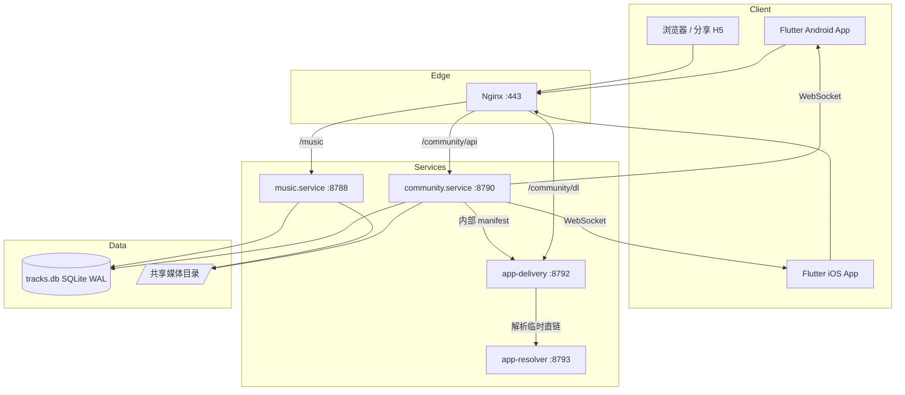

# 流萤社区 · 系统架构

> 本文回答三个问题：系统由哪些部分组成、一次请求怎么走、为什么这样拆。
> 开发环境与命令见 [`DEVELOPMENT.md`](DEVELOPMENT.md)；后端新增接口约定见 [`community/ARCHITECTURE.md`](../community/ARCHITECTURE.md)。

## 1. 系统上下文



### 1.1 边界

- 公网只到 Nginx。社区、音乐、下载网关都监听 `127.0.0.1`。
- `community.service` 是社区 API、管理后台、分享页、媒体代理的唯一入口。
- 社区与音乐共用一份 SQLite 文件；社区只新增 `community_*` 表，不改音乐表结构。
- 应用市场下载拆成 `app-delivery` / `app-resolver`，两者都不访问数据库，避免把外网解析和数据库放进同一进程。
- SQLite 不能跨机共享。当前是单机部署；横向扩容前先换 PostgreSQL/MySQL 或独立数据库服务。

## 2. 前端架构

### 2.1 壳与导航

`lib/pages/root_page.dart` 维护五个常驻 Tab：

| Tab | 页面 | 说明 |
|---|---|---|
| 首页 | `pages/home/home_page.dart` | 关注/推荐双流、Banner、榜单、话题 |
| 版块 | `pages/boards/boards_page.dart` | 多级版块与版块信息流 |
| 短视频 | `pages/shorts/shorts_page.dart` | 沉浸式上下滑、视频/图集、原声+配乐 |
| 消息 | `pages/message/message_page.dart` | 互动通知、官方消息、私信 |
| 我的 | `pages/mine/mine_page.dart` | 资料、等级、签到、会员、作品、应用投稿 |

页面首次进入才构建，之后保留在 `Offstage` + `TickerMode` 中：滚动位置、输入内容、播放进度不因切 Tab 丢失。发布键在底栏中间，发布成功通过 `PublishBus.goHome` 回首页。

### 2.2 分层

```text
lib/
  main.dart              入口、登录态恢复、首启引导、全局错误页
  api/                   HTTP 客户端、登录兜底、应用市场 API
  design/                设计令牌、通用组件、动效语言
  features/              领域数据与组件（消息 Repository、表情混排）
  models/                数据模型
  pages/                 业务页面（按领域分目录）
  services/              跨页能力（登录态、WS、发布、下载、热更新、安全）
  utils/                 草稿、封面取色、分享、响应式、播放偏好
  widgets/               跨页面复用组件
```

规则：

1. 页面不直接拼 URL；统一走 `ApiClient`，消息域走 `MessageRepository`。
2. 跨页能力放 `services/`，不把登录、WS、下载实现复制进页面。
3. `design/` 只放令牌和无业务组件，不放页面状态。
4. 请求带 token/uid 快照与请求序号；账号切换后旧响应必须丢弃。
5. 新代码优先沿用现有组件和令牌，不另起一套视觉。

### 2.3 状态与刷新

系统不引入第三方状态管理库，按状态归属拆分：

| 状态 | 所有者 | 刷新方式 |
|---|---|---|
| 登录态 / 账号切换 | `services/auth_session.dart` | `AuthSession.revision` 自增，页面监听 |
| 资料、会员、签到、头像框 | `services/user_data_bus.dart` | `UserDataBus.revision` 自增 |
| 发布完成 | `services/publish_bus.dart` | `PublishBus.completed` / `goHome` |
| 关注变化 | `services/follow_bus.dart` | 关注按钮与列表监听 |
| 未读通知/私信 | `services/notify_bus.dart` | WebSocket + REST 兜底 |
| 应用市场下载 | `services/app_download_manager.dart` | 任务状态机 + 本地通知 |

页面内分页/加载状态仍由 `setState` 持有；异步请求用请求序号或 token/uid 快照防止旧结果覆盖新状态。

### 2.4 设计系统

- `lib/design/tokens.dart`：颜色、字阶、间距、圆角、渐变、`ThemeData`。
- `lib/design/components.dart`：通用按钮、列表行、空态、头像、标签、弹层壳等。
- `lib/design/motion.dart`：骨架扫光、错峰入场、骨架切换、加载三点、AI 逐段文本、Reduced Motion。
- `lib/design/segmented_tabs.dart`：跟手分段标签与弹簧吸附。
- `lib/design/spotlight_coach.dart`：新手聚光灯引导。

页面不写字面量颜色/字号；动效必须解释状态或空间关系，并在 `MediaQuery.disableAnimations` 下退化。

### 2.5 媒体与播放

- 图片：`cached_network_image` + `BlurUpImage` 缩略图模糊占位。
- 视频：`video_player`；短视频页用 `VerticalPager` 式交互，详情页盖住时通过 `appRouteObserver` 暂停。
- 配乐：`just_audio`；短视频配乐与视频同时间轴，图集配乐整首循环；音量随作品字段 `audio_volume` / `music_volume`。
- 媒体 URL 统一由 `lib/config.dart` 拼接，支持通过 `--dart-define` 覆盖站点。

## 3. 后端架构

### 3.1 分层

```text
HTTP socket
  │
server.py                 只做 HTTP 传输：解析、请求体、CORS、响应写回
  │
app.py                    请求 ID、访问日志、health/ready/version、静态页、
  │                       请求级事务、统一异常、404
  │
core/router.py            按 routes.py 的前缀清单选择领域
  │
routes.py                 领域所有权唯一事实来源
  │
handlers/<domain>.py      精确路由、参数校验、鉴权、限流、业务编排
  │
common.py / schema.py     共享数据访问、建表、迁移
```

约束：

- `server.py` 不出现业务路径，不直接调用 handler。
- `routes.py` 只登记 `ModuleSpec(name, module, prefixes, description)`，不写业务。
- 同一路径命中多个前缀时按 `MODULES` 顺序决定优先级，重叠必须注释。
- handler 返回 `True` 表示已消费并写响应，`False` 交给下一个模块。

### 3.2 请求生命周期

1. `server.py` 解析请求，记录 `Content-Length`，调用 `Application.handle`。
2. `app.py` 生成/透传 `X-Request-Id`，写入日志上下文。
3. 非 API：health → ready → version → 静态 H5 → 404。
4. API：打开请求级 SQLite 连接，解析 uid（仅日志），按 `routes.py` 分发。
5. handler 内可显式 `commit`；请求结束 `request_connection` 统一 commit，异常 rollback 并 close。
6. `finally` 排空未读请求体，避免 keep-alive 污染。
7. 访问日志字段：`method/path/status/duration_ms/ip/uid/route/request_id`。

### 3.3 领域路由

| 领域 | Handler | 前缀 | 主要职责 |
|---|---|---|---|
| `captcha` | `captcha.py` | `/captcha` | 图片/滑块挑战，发短信/邮件前校验 |
| `auth` | `auth.py` | `/auth` | 邮箱、手机号、密码登录；音乐停服兜底 |
| `apps` | `apps.py` | `/apps`、`/internal/app-download` | 应用市场公开 API 与内部 manifest |
| `admin_apps` | `admin_apps.py` | `/admin/apps`、`/admin/app-categories` | 应用审核、分类、评论、举报 |
| `content` | `content.py` | `/post`、`/comment`、`/poll`、`/favorites`、`/video` | 帖子、评论、投票、收藏/稍后看、草稿 |
| `feed` | `feed.py` | `/feed`、`/rankings`、`/search`、`/banners` | 信息流、榜单、搜索、Banner |
| `social` | `social.py` | `/status`、`/poke`、`/together` | 今日状态、戳一戳、一起听/看 |
| `user` | `user.py` | `/user`、`/me`、`/follow`、`/notifications`、`/frames`、`/tasks` | 资料、关注、等级、装扮、签到、通知 |
| `upload` | `upload.py` | `/upload-*`、`/media`、`/music`、`/s` | 上传、转码、封面帧、媒体代理、分享页 |
| `member` | `member.py` | `/member` | 会员套餐、支付、兑换码、订单 |
| `feedback` | `feedback.py` | `/feedback` | 用户反馈 |
| `invite` | `invite.py` | `/invite` | 邀请码、归因、手机号验证、返佣、提现 |
| `af` | `af.py` | `/af` | AI 助手会话、模型/供应商、额度、账单 |
| `ai_bot` | `ai_bot.py` | `/ai-bot`、`/admin/ai-bot` | 流小萤公开资料、发帖策略、动作记录 |
| `site` | `site_admin.py` | `/site`、`/admin/site` | 官网内容与后台配置 |
| `app_release` | `app_release.py` | `/app/version`、`/admin/app-releases` | 客户端版本、安装包 |
| `app_hot_update` | `app_hot_update.py` | `/app/hot-update`、`/admin/hot-update` | 维护模式、公告、功能开关、灰度 |
| `dm` | `dm.py` | `/dm` | 私信会话、消息、已读 |
| `ws` | `ws.py` | `/ws` | 通知/私信/官方未读实时推送 |
| `admin_api` | `admin_api.py` | `/admin` | 社区后台：审核、用户、权限、运营 |

### 3.4 数据模型

数据库分三类：

1. **社区自有**：`community_posts`、`community_post_comments`、`community_boards`、`community_topics`、`community_emojis`、`community_frames`、`community_members`、`community_messages`、`community_apps`、`community_app_versions`、`community_invite_*`、`community_ai_*` 等。
2. **共享只读/授权写**：`users`、`tokens`、`follows`、`notifications`、`tracks`。
3. **应用市场独立域**：`community_app_categories`、`community_apps`、`community_app_versions`、`community_app_comments`、`community_app_ratings`、`community_app_favorites`、`community_app_reports`、`community_app_behavior_events`、`community_app_hot_*`。

建表全部幂等；新增列/表必须兼容旧库。共享表可选列运行时探测，不能假设音乐库永远有某列。

### 3.5 鉴权

| 场景 | 机制 |
|---|---|
| 客户端 API | `Authorization: Bearer <token>`，与音乐 `tokens` 表互通 |
| 访客 | 信息流、版块、帖子详情、图片/视频等只读接口允许匿名 |
| 写操作 | 强制登录；发帖/评论/点赞/上传均有频率限制 |
| 管理后台 | `X-Community-Admin-Token`，按管理员等级与模块权限校验 |
| WebSocket | 握手 `?token=` 校验，断线由 REST 未读补齐 |
| 下载网关 | HMAC ticket + 内部 `X-Internal-Token` |

### 3.6 关键链路

#### 登录

```text
客户端 → 音乐 /music/api/login
      ├─ 成功：拿 token + 用户资料
      └─ 音乐 5xx/不可达：回退 /community/api/auth/login
社区登录 → 校验共享 users.password_hash → 签发/复用共享 tokens
```

#### 发帖与审核

```text
POST /post → 敏感词/频率/附件校验 → community_posts(audit_status=0)
后台审核通过 → audit_status=1 → 进入 feed/版块/个人主页
拒绝 → audit_status=2 + reason → 作者收到审核通知
编辑已通过帖子 → 不顶帖，按策略重新进入审核
```

#### 私信与实时

```text
REST 拉会话/消息 ←→ SQLite community_dm_messages
WebSocket 推送新消息/未读 → 客户端更新会话与红点
已读回执 → /dm/read → 对端未读清零
```

#### 一起听 / 一起看

```text
创建房间 → 房间码/邀请卡 → 对方加入
房主切换曲目/视频/进度 → /together/sync → 双端轮询/WS 对齐
离开/超时 → 房间关闭，媒体停止
```

#### 应用市场下载

```text
GET /apps/{id}/download
  → 校验应用与版本可用
  → HMAC ticket(v=versionId,a=appId,exp)
  → 302 /community/dl/{ticket}
  → Nginx → app-delivery:8792
  → 校验 ticket → 主服务内部 manifest → app-resolver:8793
  → 按 Range 转发
```

#### 会员与支付

```text
/member/plans → 下单 → 易支付/兑换码 → 回调校验 → community_members 开通
订单状态与权益由服务端判定，客户端只展示结果
```

#### 客户端更新

```text
/app/version → 强更/建议更新 → 下载 APK 或跳转 IPA
/app/hot-update → 维护模式、公告、功能开关、灰度
Shorebird 补丁只替换 Dart 代码，不参与版本比较
```

## 4. 部署拓扑

```text
Nginx :443
 ├─ /music/          → music.service :8788
 ├─ /community/api/  → community.service :8790
 ├─ /community/dl/   → app-delivery :8792
 ├─ /community/      → 后台/分享页/媒体
 └─ /                → community-site 静态官网

systemd:
  music.service
  community.service
  app-resolver.service
  app-delivery.service
```

生产配置只通过环境变量 / `EnvironmentFile` 注入；仓库不保存数据库、上传目录、证书、keystore、SMTP 密码、支付密钥。

## 5. 设计权衡

- **模块化单体而非微服务**：社区业务共享大量用户/内容/通知数据，单进程 + 单库能保证事务简单；仅把高风险的下载解析拆出去。
- **SQLite 而非一开始就上 PostgreSQL**：单机阶段运维成本最低，WAL 足够支撑当前量级；代价是不能跨机共享，扩容前必须迁移。
- **Flutter 单代码库**：双端交互和视觉一致，发布/短视频/私信只维护一套；代价是 iOS 构建依赖 macOS/CI。
- **共享数据平面而非复制用户表**：避免双写和密码哈希分叉；代价是社区运行依赖同一份 DB 文件，必须做好备份。
- **页面内 `setState` 而非全局状态库**：降低迁移成本，保持现有页面行为；通过 Bus 和请求快照解决跨页刷新与竞态。

## 6. 已知边界

- SQLite 单文件是单点故障；依赖备份恢复，不能双机同时写。
- 音乐进程停服不影响社区大部分能力，但共享 DB 文件损坏会同时影响两端。
- 登录型网盘不做匿名绕过；仅支持公开直链/GitHub Releases，或部署方自有的授权解析服务。
- iOS 仓库只产出未签名 IPA，安装需要自签或 sideload。
- 社区 AI 的模型/额度依赖外部供应商配置，未配置时相关入口应降级而不是阻塞主流程。
